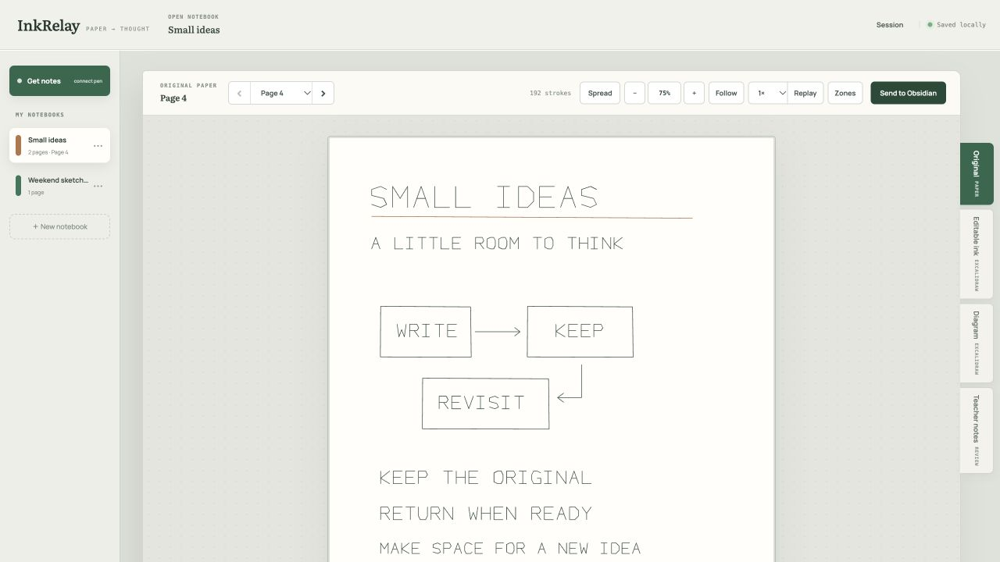
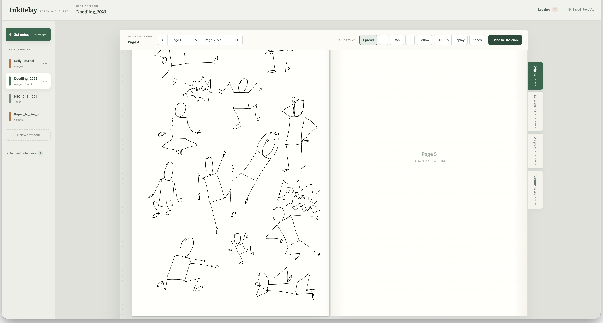
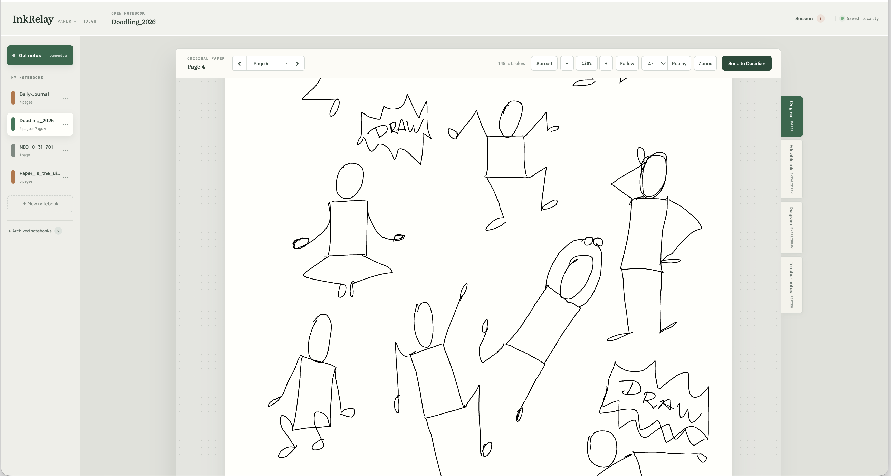
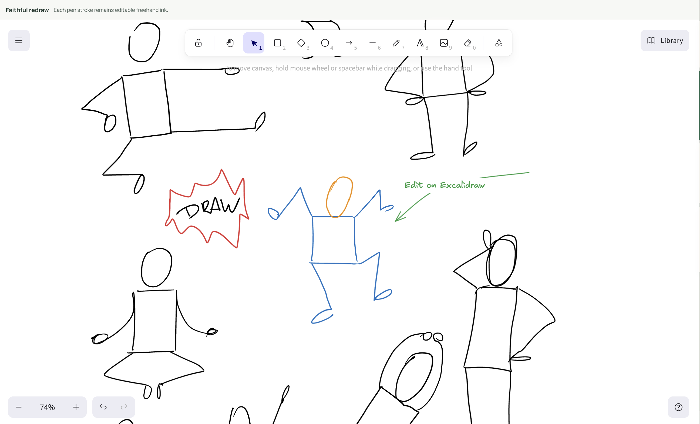
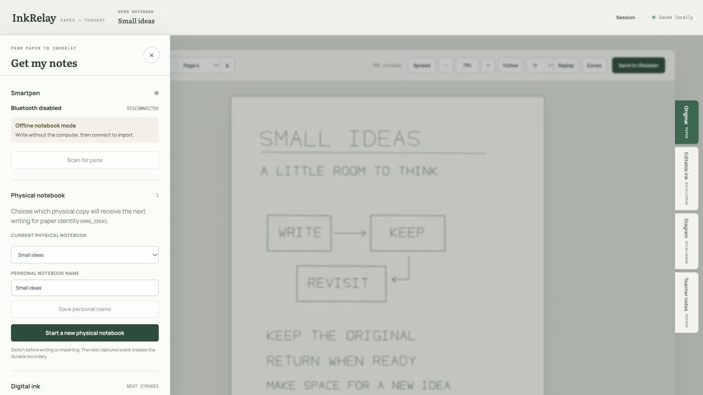
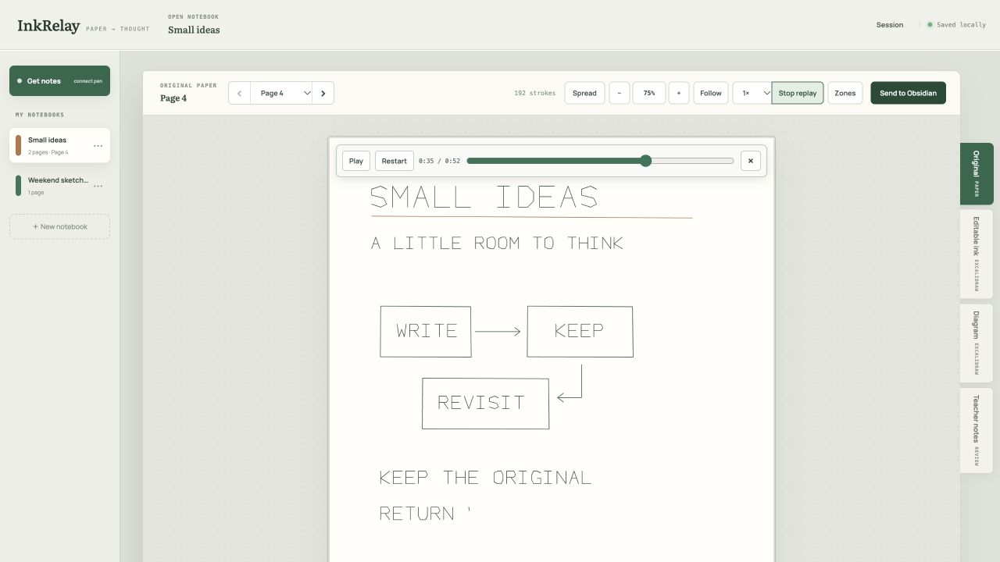
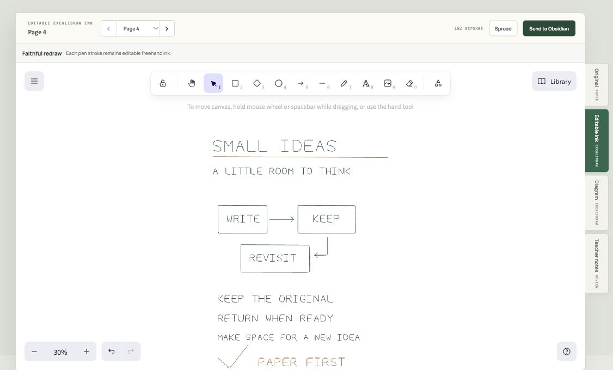
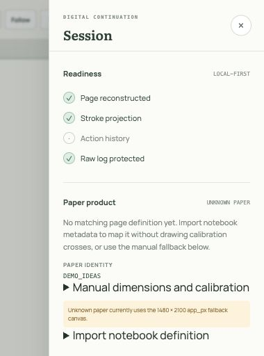
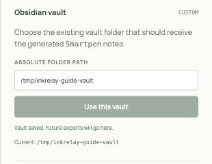
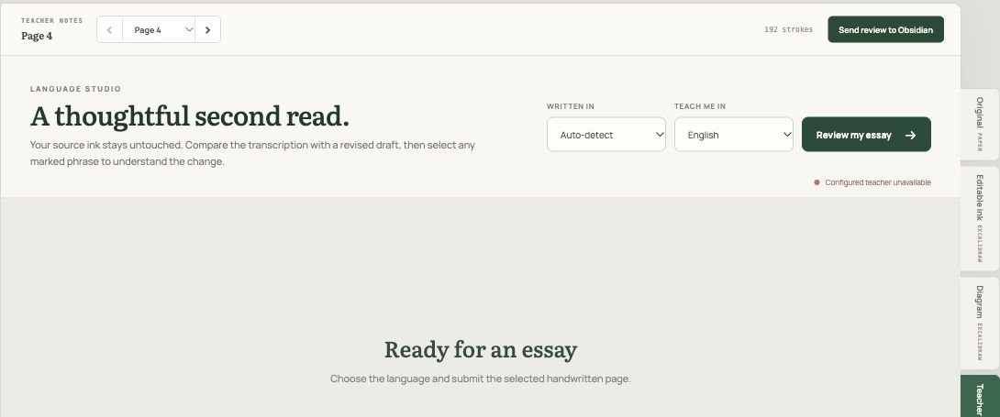

# InkRelay

**Local first. Your notes and notebooks, on your computer.**

InkRelay is a **local-first** Neolab's smartpen companion. Your notes are stored on your own computer: **no cloud storage or online account is needed to keep your notes**. Bring in writing saved inside the pen, watch writing arrive live, revisit a page, turn a sketch into an editable diagram, or send a copy to Obsidian. You can keep writing in a physical notebook without organizing everything on a screen first.

**Project status: in development.** Beta tested on Mac and Linux. Features and device support are still evolving. This community project currently needs an initial setup with development tools; there is no one-click installer yet. You do not need to be a programmer if an AI assistant can help with that setup.

[](docs/images/01-original.jpg)

*Your notebooks sit on the left, the selected page stays in the centre, and its digital tools sit on the right.*
[](docs/images/08-shared-real-strokes.png)

*Real pen strokes, original paper preserves your writing or drawings.*

[](docs/images/09-shared-strokes-closeup.png)

*Multi page view or single-page. Zoom in your ideas*


*Bring your notes and ideas to Excalidraw*

**Start here:** [Set up the app](#get-started-with-an-ai-assistant) → [Bring in your notes](#bring-in-your-first-notebook) → [Explore the illustrated guide](#a-quick-tour-with-pictures).

## What you can do

- **Get your notes:** import writing from pen memory, with the option that retains it on the pen. Repeating an import avoids duplicate strokes.
- **Write live:** see a stroke after you lift the pen from the page.
- **Read and replay:** browse physical notebooks, zoom, view a two-page spread, and replay handwriting.
- **Continue digitally:** edit faithful freehand ink in Excalidraw, or try conservative shape recognition while keeping uncertain marks as ink.
- **Keep an Obsidian copy:** export a page and its source-linked files. Your separate personal notes file is preserved.
- **Optional language feedback:** deliberately submit a handwritten page to a configured vision model for transcription, corrections and teaching notes.

**Your note storage is local.** Capturing, storing, reading, replaying and exporting ink do not require AI or a cloud account. AI language feedback is an optional feature that you configure separately.

## Will it work with my computer and pen?

| Your setup | Current support |
| --- | --- |
| **Mac, macOS 12 or newer** | Native Bluetooth implemented. LAMY safari connection, stored-note import, repeat import and restart recovery tested on Apple silicon. Live writing/controller checks are still pending on macOS. Intel builds are not yet hardware-verified. |
| **Linux with BlueZ** | Native Bluetooth; live and offline workflows tested with a LAMY safari all black ncode pen. |
| **Windows** | No native pen connection yet. The interface, replay and exports can be explored with Bluetooth disabled; full Windows validation is pending. |
| **Other Neo protocol-v2 pens** | Candidates for testing, not guaranteed compatible. |
| **Ordinary pens or non-Ncode paper** | Not supported. |

You need a compatible Neo-protocol smartpen and Ncode paper. The app reads an identity printed into the paper; it cannot recognize every notebook's size automatically. Three previously measured product references are included. Other paper may need a matching notebook definition or the manual calibration fallback. You are not expected to have a `.nproj` file, and there is no public catalog download built into the app. [Paper support explained](docs/neo-linux-hardware.md#paper-identity-and-coordinates).

## Get started with an AI assistant

Copy this repository's GitHub URL from your browser and give it to an AI coding assistant that can work on your computer. The assistant can clone the repository, follow its setup guide and help you get started. A chat assistant without computer access can explain the steps but cannot install the app for you.

Use this prompt, replacing `REPOSITORY_URL` with this repository's URL:

> Help me install and start using InkRelay from this GitHub repository: `REPOSITORY_URL`.
>
> Work on the computer where I will connect my smartpen. Use an existing checkout if I already have one; otherwise clone the repository locally. Read `README.md` and `skills/inkrelay-setup/SKILL.md`, detect my operating system, explain any support limits, and follow the setup instructions. Guide me through required installers and Bluetooth permissions.
>
> My smartpen transfers data representing my personal handwritten notes. These notes are meant to be stored locally on my computer, and I use an Obsidian vault. Preserve my existing notes and configuration, keep InkRelay on localhost, and help me identify the vault folder to use for exports.
>
> Get the core capture workflow working first. Guide me through connecting the pen, importing stored writing while retaining it on the pen, browsing pages and exporting a copy to Obsidian. If I want Teacher notes, explain the local vision-model and compatible LLM-endpoint options, including where a submitted page would be processed, then help configure the option I choose.
>
> Explain everything in plain language. Finish by showing where my captured notes and exports are saved, what to back up, and how to start and stop InkRelay next time.

**Prefer a ZIP download?** Choose **Code → Download ZIP**, unpack it, and open that folder in your assistant. Use the same prompt, replacing the repository/cloning instructions with “Use the InkRelay project in this folder.”

The [setup skill](skills/inkrelay-setup/SKILL.md) is plain Markdown that other coding assistants can read too. It does not install itself or grant permission to access your notes.

Your assistant will need:

- **Node.js 22.19 or newer** and **pnpm 10** (the project pins pnpm 10.10.0).
- On Mac: **Apple Xcode Command Line Tools** to build the small Bluetooth helper. The helper builds automatically when starting the development server or building the app.
- On Linux: **BlueZ** and permission to use the system Bluetooth service.

Python, Docker and model downloads are needed only for the optional language teacher.

## Prefer to run the setup yourself?

From your local project folder, whether cloned or unpacked from a ZIP, after installing the prerequisites:

```bash
pnpm install --frozen-lockfile
cp .env.example .env
pnpm build
pnpm start
```

**If `.env` already exists, keep it: do not overwrite it with the copy command.** On macOS, install Apple's Command Line Tools first if they are missing (`xcode-select --install`).

Open [InkRelay on this computer](http://127.0.0.1:4317). Keep the terminal running while using the app. To stop it, press **Ctrl+C** in that terminal. Next time, open the same folder and run `pnpm start`; rebuild after source updates. Mac users may need to allow the Bluetooth permission prompt. See [Mac setup](docs/macos-hardware.md) or [Linux setup](docs/neo-linux-hardware.md).

For development, `pnpm dev` opens the interface at [localhost:4318](http://127.0.0.1:4318), with the server on port 4317. To explore without a pen, set `INKRELAY_BLUETOOTH_ENABLED=false` in your local `.env` before starting. Ask your assistant to load synthetic demo input into a separate demo data folder, without mixing it into your real notebooks.

## Bring in your first notebook

1. Wake the pen and disconnect Neo Studio or other pen apps that might already be using it.
2. Open **Get notes → Scan for pens**, select the pen and connect. Allow the operating system's Bluetooth prompt if shown.
3. If you own multiple copies of a notebook with the same printed identity, choose the intended physical copy before importing.
4. Choose **Import stored writing** and leave the pen connected until the summary appears. InkRelay requests that the writing stay on the pen.
5. Choose a notebook and page from the shelf. Start with **Original** to check the faithful ink.

[](docs/images/02-get-notes.jpg)

*Open **Get notes** to find the connection controls and choose the physical notebook receiving your writing. Scan and connect; **Import stored writing** appears once connected.*

InkRelay can operate in two ways:
1. **Write offline import later:** The ideal way of working with InkRelay. When you use your smartpen without any device connected, your strokes are stored on the pen's memory.  Those strokes can later be imported into both InkRelay and Neo software, **disconnect first, write offline, then import**.
2. **Capture live writing:** Connect your pen and write down, your strokes will appear on screen. Capture live writing via InkRelay comes with the disadvantage, your live notes cannot be later transferred to official NeoLabs application. Why? During live capture, the strokes are not stored on the smartpen memory but transfered directly to connected device.

## Find your way around

| On the screen | What it is for |
| --- | --- |
| **Original** | Faithful source paper, zoom and handwriting replay. |
| **Editable ink** | Excalidraw freehand editing. |
| **Diagram** | Editable recognized shapes, with handwriting retained where recognition is uncertain. |
| **Teacher notes** | Optional, explicitly requested language review. |
| **Get notes** | Pen connection, import, ink style and physical notebook selection. |
| **Session** | Paper setup, export-folder settings and diagnostics. |

To export a page, choose an existing Obsidian vault under **Session → Obsidian vault**, then use **Send to Obsidian**. Obsidian is optional; without it, the example export folder is `tmp/demo-vault` inside this project.

## A quick tour with pictures

### 1. Open a notebook and find your page

Choose a notebook from the left-hand shelf, then use the **Page** menu or the arrows above the paper. Page navigation stays within the selected notebook. **Spread** opens facing pages; a page you have not captured appears blank. Use **+** and **−** to adjust the view. **Original** is the place to check what the pen actually captured, as shown in the opening image.

### 2. Watch the writing happen again

In **Original**, choose **Replay**. Use **Play/Pause**, **Restart**, or drag the timeline to revisit a particular moment. The speed menu above the page lets you slow down or speed up playback; **Follow** keeps the view near the writing. Choose **Stop replay** to return to the complete page.

[](docs/images/03-replay.jpg)

*Replay follows the order of the captured pen strokes. Moving the timeline changes the playback position without changing your notes.*

### 3. Continue a sketch digitally

Choose **Editable ink** on the right edge to open your captured strokes in Excalidraw. Use the selection arrow to select ink, the pencil to add marks, or the text and shape tools to extend your page. The hand tool moves around the canvas.

[](docs/images/04-editable-ink.jpg)

*A close-up of the editing workspace. **Editable ink** preserves freehand strokes; **Diagram** tries to turn suitable marks into editable shapes and connectors.**
[](docs/images/10-shared-excalidraw-editing.png)

*Excalidraw: recolor individual marks, add text and draw arrows while continuing your sketch digitally.*

These edits are currently a browser-local convenience cache. Save important changes with Excalidraw's own export tools; the Obsidian page export does not include these browser edits.

### 4. Check paper setup when the size looks wrong

Open **Session → Paper product**. A matching paper reference or notebook definition can supply the mapping automatically. If your paper is unknown, expand **Manual dimensions and calibration** to enter its size and use the calibration fallback when needed. A `.nproj` file is optional and is not normally supplied with a consumer notebook.

[](docs/images/05-paper-setup.jpg)

*This invented paper identity has no matching definition, so the app shows its fallback. Your real paper may already have a known reference. [Read about paper support](docs/neo-linux-hardware.md#paper-identity-and-coordinates) before changing an existing calibration.*

### 5. Send a copy to Obsidian

Open **Session**, scroll to **Obsidian vault**, enter the full path to your existing vault folder, and choose **Use this vault**. Close the panel, select the page you want, then choose **Send to Obsidian** above it. Find the generated page under the vault's **Smartpen** folder.

If you are unsure where your vault is, ask your setup assistant to help find the folder.

[](docs/images/06-export-folder.jpg)

*The folder in this picture is a temporary demonstration vault. Use your own vault's location. The saved choice controls subsequent exports; it does not move your captured source ink.*

### 6. Ask for language feedback, when you want it

**This optional feature requires the language-teacher worker and a vision-capable language model.** You can run a model locally on your own computer, or connect the worker to a compatible LLM endpoint on your local network or in the cloud. A remote endpoint receives the page you submit for review.

Follow [the language-teacher setup guide](docs/language-teacher.md) first. Then select an essay page and choose **Teacher notes**. Set **Written in** to the page's language, choose your explanation language under **Teach me in**, then choose **Review my essay**. Compare the transcription and revised draft with the source, and select marked phrases to explore explanations. **Send review to Obsidian** exports the review once one exists.

[](docs/images/07-teacher.jpg)

*This is the screen before a review. The demo has no running teacher, so it shows **Configured teacher unavailable**. [Set up the language teacher](docs/language-teacher.md) when you are ready; normal capture and reading work without it.*

## Your notes and privacy

- **No cloud is needed to store your notes.** InkRelay saves the captured source and notebook metadata on your computer. A cloud service is only involved if you deliberately configure one, such as a remote model for language feedback.
- Captured source events and notebook metadata are saved under **`tmp/inkrelay-data` by default**. Despite its name, this folder is persistent data: **back it up and do not delete it when updating the app**.
- Exported demo-vault files are under `tmp/demo-vault`. A vault you choose elsewhere stays at that location. Back it up separately.
- Keep your local `.env` and, if used, `.env.language` private. They can contain paths and service credentials.
- Personal notes, notebook metadata, exports and screenshots are excluded from the shared source by default. Seven demo images use synthetic examples; three additional screenshots of real doodles and editing were explicitly selected by their owner for public sharing. These exceptions include only the displayed images, not its underlying note data or other personal screenshots.
- The server is a local tool without account authentication. Keep the default **127.0.0.1** address; do not expose it to your network or the internet.
- A configured remote language-model service receives an image of a submitted page. An AI setup assistant may also transmit anything you paste or let it upload. Installation does not require giving it the contents of your notebooks.

Source code updates are not backups. Make a copy of your data folders before replacing the project folder. [More storage and recovery details](docs/development.md).

## Optional: language teacher

Once pen capture works, you can add handwritten-essay feedback. It transcribes the page and suggests language corrections; both transcription and feedback can be wrong, so compare them with Original paper.

Language feedback needs a separate Python worker connected to a **vision-capable model**, either a **local model** or a **compatible LLM endpoint**. The local setup runs the model in Docker and needs additional disk space, memory and a model download. A remote endpoint is an optional alternative and receives the page you submit for review; it is not needed for note storage. Model licences and provider terms apply separately. Ask your assistant to follow [the language-teacher guide](docs/language-teacher.md), explain the selected endpoint, and get your agreement before sending a page there.

## When something goes wrong

| Problem | First thing to try |
| --- | --- |
| No pen found | Wake it, keep it nearby and disconnect other pen apps. Check Bluetooth permission, then **Retry Bluetooth**. |
| Ink is the wrong size or position | Open **Session → Paper product**. Known references may map automatically; unknown paper can use the manual fallback. |
| An import was interrupted | Reconnect and retry. Imports retain writing and deduplicate existing events. |
| Notes seem missing | Check the notebook/page selection and data folder before changing anything. Ask your assistant to inspect; do not clear or delete data. |
| A port is already in use | The app may already be running. Use the existing window or stop the old instance. |

For help, describe your operating system, pen model and what happened. **Do not attach real notes, `.env` files, API keys, Bluetooth identifiers or unredacted screenshots to a public issue.** Your assistant can help create a small synthetic reproduction.

## Licence and credits

The proposed source licence is **GNU GPL version 3 only**; see [LICENSE](LICENSE). Sharing the software does not grant anyone rights to your notes. Third-party code, fonts, models and vendor materials retain their own licences. InkRelay is a community project, not an official NeoLAB, LAMY, Moleskine or Obsidian product.

The Neo protocol implementation was developed using publicly available vendor references. Upstream GPL/commercial wording needs care; the [licensing review](docs/licensing.md) explains the proposed choice and unresolved provenance questions. [Third-party acknowledgements](THIRD_PARTY_NOTICES.md) include Excalidraw, fonts and the software libraries used by the app.

For contributors and AI agents: [AGENTS.md](AGENTS.md) · [Development](docs/development.md) · [Architecture](docs/architecture.md) · [Roadmap](docs/roadmap.md).
