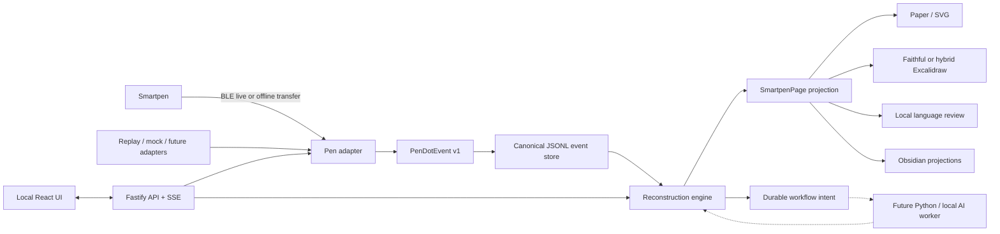
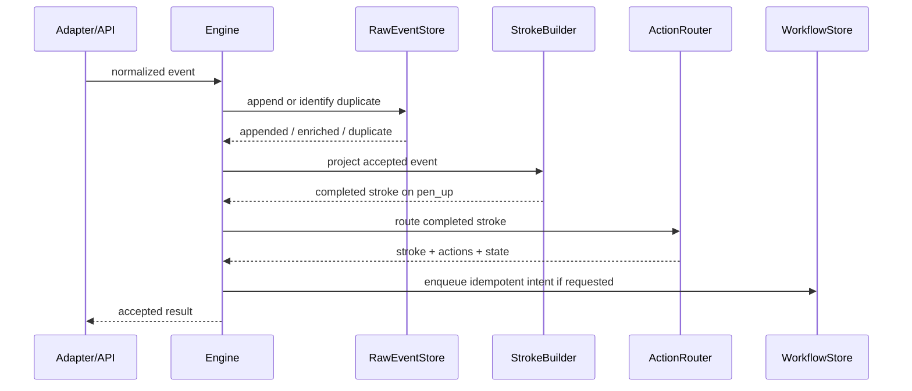

# InkRelay architecture

This document describes the current system, its ownership boundaries, and the intended direction. The implementation is an MVP, but its event-first architecture is deliberate.

## Design goals

InkRelay should:

- work without a cloud service after installation;
- preserve captured pen data before attempting interpretation;
- support immediate live interaction and delayed offline import;
- reconstruct all derived state after a process restart;
- let TypeScript coordinate devices, storage, UI, workflows, and Obsidian;
- let Python provide optional OCR, computer vision, and AI without owning canonical data;
- support additional pens through adapters instead of leaking vendor packets into the domain;
- keep paper useful as an offline human interface that can request later computer workflows.

## System context



Solid lines are implemented data paths. The user-triggered language review is implemented independently of the dashed generic workflow queue; the server does not yet schedule queued paper-action workflows automatically.

## Layer ownership

### Hardware and input adapters

`packages/adapters` converts source-specific data into `PenDotEvent`. The Linux Neo path owns BlueZ discovery, GATT connection, protocol negotiation, authentication, packet parsing, live-mode commands, offline note enumeration, download, and acknowledgements.

Native transport selection is OS-specific: BlueZ/D-Bus on Linux and a Swift Core Bluetooth child process on macOS. `NeoPenManager` accepts the same `NeoPenTransport` interface for both; `NeoProtocolV2` remains the only packet interpreter. The macOS helper exchanges version-1 JSONL requests/results and connection-scoped raw-byte notifications over private pipes; it has no vault, canonical-storage or network role. Windows native capture reports unsupported explicitly. Native lifecycle, flow control, permission handling and rollback are documented in [macOS hardware setup](macos-hardware.md).

Adapters may preserve source-specific identifiers in normalized `penId`, `sessionId`, `notebookId`, and `pageId`, but no downstream package should need Neo packet structures.

The current Neo paper identity mapping is:

```text
notebookId = NEO_<section>_<owner>_<note>
pageId     = <page>
```

Neo coordinates are normalized to source `app_px` at ten units per reported coordinate. This source conversion is retained in canonical events. A versioned local paper catalog can override the canvas dimensions and apply an axis-aligned affine projection (`scaleX`, `scaleY`, `offsetX`, `offsetY`) for a detected notebook identity; unknown paper retains the configured fallback and identity transform.

Automatic paper geometry uses vendor-neutral `PaperDefinition` ranges in `PageMapper`. The adapter owns `.nproj` parsing and measured Neo product references; the server owns local import history. Saved manual profiles override imported definitions, which override bundled measured references; unknown pages retain the original fallback. Canonical source coordinates and manual catalog v2 are unchanged. See [paper mapping and rollback](neo-linux-hardware.md#metadata-geometry-and-compatibility) for units, precedence, schema and limitations.

### Domain and validation

`packages/core` defines the versioned event and page models, Zod validation, stroke assembly, deterministic stroke IDs, profile-aware page mapping, and extension interfaces.

A stroke begins on `pen_down`, accumulates moves, and becomes visible when `pen_up` completes it. Malformed sequences produce bounded warnings instead of inventing ink. Style is captured at stroke start so later controller changes affect subsequent strokes.

### Canonical storage and reconstruction

`RawEventStore` in `packages/obsidian-writer` owns append-only session JSONL. Despite its package location, this store is not an Obsidian projection: it is the application recovery source.

The engine performs each ingestion serially:



Events are identified by `(penId, sessionId, sequence)`. A repeated event is not projected twice. The store supports one append-only enrichment case: if a later copy of the same event adds a missing color, it appends the enriched record; replay takes the newest record for that identity.

At startup, the engine reads all event files, deduplicates them, orders them by source timestamp and identity, and rebuilds pages, actions, session state, and in-memory workflow views. Canonical files therefore survive app restarts even though page projections live in memory.

Physical notebook identity is a separate projection because Neo paper identity is not necessarily unique to one physical copy. `notebook-instances.json` stores user-named instances, the active instance for each source paper identity, durable `(paper identity, pen, session, start sequence) → physical instance` boundaries, and append-only capture-range corrections. New events are appended canonically with their original `notebookId` before assignment. Replay applies recorded boundaries and then the latest matching correction; unassigned legacy events remain in a default instance whose ID equals the original notebook ID.

The physical-notebook catalog uses schema `inkrelay.notebook_instances.v3`. Existing v1 catalogs migrate with an empty correction history, and v1/v2 instances migrate as unarchived; the migrated catalog is written as v3 on the next metadata change. Archiving adds reversible presentation metadata and removes the instance from active routing, but does not remove canonical events or any derived files. Reassignment is serialized with ingestion, validates that every event in the selected range still belongs to the displayed source instance, appends an auditable correction, and rebuilds page/action/workflow projections from canonical events. If the range contains a workflow action, the outbox appends a newer routing projection under the same deterministic intent ID; readers select the latest record. Reassignment does not rewrite raw JSONL, delete older language reviews, or remove previous Obsidian exports.

### Actions and session state

`packages/action-router` reads `config/action-zones.json`. A configured zone activates only when a short completed stroke is fully contained in its bounds. The action may change color/width for later strokes, mark a page, establish a pending action, or create a future workflow request.

The capture drawer exposes the same current color and width as direct controls through `PUT /api/ink/style`. Changes are serialized with ingestion and affect only strokes whose `pen_down` arrives afterward; completed strokes and source coordinates remain unchanged. Paper-controller actions can still replace the current selection.

The current file contains generic demonstration zones plus a measured mapping for page 11 of `NEO_3_1013_1`, the tested LAMY Paper Controller card. The UI hides that command surface from the ordinary page list. This is a prototype mapping and should eventually become catalog/profile data rather than a UI constant.

### Page projections

`packages/render-svg` creates deterministic SVG from canonical page strokes. It omits `action`-only marks.

Paper calibration is applied when completed source strokes enter the page projection, before action routing and all downstream renderers. Updating a profile reprojects in-memory strokes through the old inverse and new transform. Canonical `PenDotEvent` coordinates and exported raw event sidecars remain unchanged, so restart/replay deterministically rebuilds the calibrated page.

The Paper view can replay visible handwriting from the same canonical stroke projection. Playback preserves stroke order and intra-stroke timing, compresses long pauses between strokes, and provides pause, restart, timeline scrubbing, preselected speed, and optional pen-tip auto-follow. Replay auto-follow uses a restrained 130% zoom plus a damped comfort-zone camera: the viewport stays still while the pen remains in its central area and glides only as writing approaches an edge. Replay position is transient browser state: it neither changes nor duplicates canonical events, reconstructed strokes, or exports.

`packages/render-excalidraw` creates deterministic derived elements:

- Faithful mode emits one free-draw element for every visible completed stroke.
- Hybrid mode recognizes geometry conservatively. It tolerates modest open/slanted rectangle corners and can assemble connected multi-stroke rectangles and diagram-sized diamonds. Confident ellipses, lines, arrows, and dashed connectors also become native elements; all other strokes stay free-draw. Size, connectivity, perimeter, and edge-fit guards keep compact handwriting and interior labels from being absorbed into shapes.
- Every generated element carries source stroke IDs and a renderer version in `customData`.
- Recognition is synchronous and deterministic. It does not use OCR or a model.

The browser merges fresh generated elements with edits stored in `localStorage`. Generated element IDs make this stable within a renderer version. The cache is browser-local and disposable. It is not sent to the backend, included in restart reconstruction, or exported to Obsidian.

The browser can also compose two independently projected pages into a spread. It uses conventional even-left/odd-right pairing by default, translates the right page into a shared Excalidraw workspace, and adds locked page-boundary elements. Source pages, stroke IDs, and coordinates remain independent; the spread is a disposable projection. Manual pair overrides are browser-local layout preferences and can always be reset to automatic pairing.

### Obsidian writer

`packages/obsidian-writer` writes a generated Markdown page, a separate user-owned notes file, SVG, events, strokes, actions, and a hash manifest. When a durable language review exists, the same TypeScript-owned export also atomically publishes a generated review note under `Smartpen/Reviews/<physical-notebook>/Page_<page> Review.md`. It contains the model transcription, ordered corrections, natural corrected essay, teaching guidance, provenance, staleness state, and a backlink to the handwritten page. Python still never writes the vault.

Each distinct page/event snapshot has a deterministic generation ID. Generation files are prepared first, the manifest is published after them, and the visible Markdown page is atomically replaced last. This prevents an interrupted export from pointing the note at a mixed set of projections. Full vault-relative links keep notebook navigation unambiguous.

The notes file is created once and never overwritten by InkRelay. On the first export using `inkrelay.obsidian_page.v1`, manual text inside the legacy marker pair is copied into it. The old flat-layout files are retained untouched for rollback; InkRelay does not automatically delete legacy files or older generations.

Obsidian files are projections, not the only copy of the source. The canonical session logs under `INKRELAY_DATA_PATH` should be backed up separately until a first-class backup/export facility exists.

### Workflows and Python

`packages/workflows` converts `ai_stub` paper actions into versioned, deterministic workflow intents and append-only run records. The queue survives restart and duplicate import.

`PythonHttpWorkflowExecutor` defines the future process boundary:

- `GET /health`
- `POST /v1/workflows/execute`
- request schema `inkrelay.python_request.v1`
- result containing Markdown and provenance metadata

Python should perform inference and return structured results. TypeScript should retain responsibility for job identity, retries, status transitions, validation, provenance, user approval, and all vault writes. The executor class and sample worker exist, but automatic queue execution and result persistence do not.

The first concrete AI projection is the explicit Language teacher flow in `services/language-worker`. It receives a versioned page request, renders source strokes to a cropped PNG, calls a configured OpenAI-compatible multimodal endpoint, and returns structured transcription/corrections. The endpoint may be bundled Ollama, another local or LAN server such as vLLM, or an explicitly selected cloud service; remote use sends the rendered page outside the machine. TypeScript validates and appends `inkrelay.language_review.v1` results with input digest, source stroke IDs, and model/pipeline provenance. Review identity includes source content, language settings, provider, model, endpoint, and pipeline version, so switching backends cannot silently reuse another backend's review. This synchronous user action does not consume the generic queued paper-action outbox yet.

### Local API and UI

`apps/server` combines the engine and pen manager behind a localhost Fastify service. `/api/events` currently sends a complete engine/pen snapshot whenever either changes. This is simple and correct for an MVP; high-volume or multi-client use should move to versioned delta events.

`apps/web` is a paper-first operator and research interface. The persistent shell gives the full workspace to Paper, editable Ink, Diagram, or Review modes. Bluetooth/import controls live in an on-demand Capture drawer; workflow state, paper actions, warnings, and diagnostics live in an on-demand Session drawer. This presentation hierarchy is defined in `docs/ui-design.md`. The browser should never become the only owner of captured ink.

## Capture flows

### Live capture

1. InkRelay connects and negotiates a Neo protocol-v2 session.
2. The adapter enables live transmission.
3. Dots are normalized and appended immediately.
4. The page updates after each completed stroke.
5. InkRelay owns persistence of those live events.

Observed on the tested pen: strokes transmitted to a connected app are generally not duplicated into the pen's later offline download. Do not promise official Neo-app availability for live InkRelay strokes.

### Offline import

1. The user writes while no app is connected.
2. InkRelay later connects and requests the stored-note list.
3. It downloads each note with the retain-data option.
4. Each packet is parsed and its events are durably ingested.
5. Only then does InkRelay send the success acknowledgement.
6. Repeat imports are safe because event IDs are deterministic.

This is the preferred compatibility path when users want InkRelay and Neo software to ingest the same stored pen data.

### Restart and recovery

1. The engine loads canonical session JSONL.
2. The latest record for each event identity wins.
3. Events are replayed in chronological order.
4. Strokes, actions, pages, and queued workflow views are reconstructed.

No Obsidian export is needed for recovery. Browser Excalidraw edits are outside this recovery flow today.

## State ownership summary

| State | Owner | Durable | Regenerable |
| --- | --- | --- | --- |
| Normalized pen events | Raw event store | Yes | No; this is canonical |
| Completed strokes and pages | Engine memory | No | Yes, from events |
| Physical notebook instances/assignment boundaries | Notebook-instance store | Yes | Instance assignments are user-owned metadata |
| Action history/session state | Engine memory | No | Yes, from events + zone config |
| Workflow intents/runs | Workflow JSONL | Yes | Intents can be derived; run history cannot |
| Paper SVG | Renderer/API or vault | Export only | Yes |
| Obsidian generated note/sidecars | Vault | Yes | Yes, from events |
| Obsidian page notes | Vault | Yes | No; user-owned and never overwritten |
| Generated Excalidraw scene | Browser | `localStorage` only | Yes from page, losing user edits |
| User Excalidraw edits | Browser | Best-effort cache | No |
| Language-teacher reviews | Language-review JSONL | Yes | Yes, with potentially different model output |
| Other future OCR/AI results | Not implemented | Must be durable projection | Must retain provenance |

## Scaling boundaries

The following are accepted MVP constraints, not architectural commitments:

- all reconstructed pages reside in server memory;
- startup replays the full event corpus;
- SSE publishes full snapshots;
- unknown page size uses one globally configured fallback;
- one pen is actively managed at a time;
- one tested Paper Controller identity is hardcoded in the UI;
- the file store has no transaction index or schema migration tool;
- Excalidraw scenes have no server persistence or Obsidian export.

These may change while preserving the contracts in [Design contracts](design-contracts.md).
