# Local language teacher

The Language teacher tab reviews a selected handwritten page as a short essay. It directly sends a locally rendered image to a multimodal model, receives a faithful transcription plus grammar corrections, and lets the learner click each corrected phrase to see the rule and examples.

This is an experimental teaching aid. Handwriting transcription and grammatical feedback can be wrong, especially with dense, cursive, faint, mixed-language, or poorly calibrated pages. InkRelay always preserves the source ink and labels the transcription as model-read content.

## Implemented flow

```mermaid
flowchart LR
    Page["Canonical SmartpenPage"] --> Hash["Page + language + model identity digest"]
    Hash --> Worker["uv-managed Python worker"]
    Worker --> PNG["Cropped high-contrast PNG"]
    PNG --> API["OpenAI-compatible vision API"]
    API --> Validate["Pydantic + Zod validation"]
    Validate --> Store["Append-only language review"]
    Store --> UI["Clickable corrected phrases"]
```



1. The user selects a page, writing language, and explanation language.
2. TypeScript hashes the page, settings, provider, model, pipeline version, and endpoint. Only an unchanged combination reuses its existing review.
3. The Python worker renders visible canonical strokes—not a browser screenshot—to a cropped PNG.
4. It sends a text-and-image chat request to an OpenAI-compatible endpoint.
5. The model returns a faithful transcription, corrected essay, ordered corrections, contextual vocabulary guidance, explanations, examples, strengths, and next steps.
6. Python and TypeScript validate the result. TypeScript assigns deterministic correction IDs and appends the review to disk.
7. The UI presents a teacher-marked review sheet. Each inline annotation shows the learner's original wording beside the correction, is color-coded by feedback category, and opens a focused explanation with examples when clicked. Corrections are located and displayed in essay reading order even if a model returns its structured correction list in a different order. The original model transcription remains available in a disclosure below the reviewed copy.

Reviews record the page update time, input digest, source stroke IDs, requested/detected languages, model/provider, pipeline version, and input mode. Editing the page makes an older review visibly stale without deleting it.

Pipeline `inkrelay-language-vision-v2` treats the writer explicitly as a language learner. In addition to grammar and spelling, it checks contextual vocabulary for literal translations, false friends, phonetic confusion, idiom, register, and culturally dependent usage. It explains the relevant distinction without treating one regional variety as universally correct. When intent is ambiguous, feedback uses “Did you mean …?” rather than presenting an inference as certain. The faithful `original_text` remains separate and is never silently normalized. The pipeline-version change deliberately creates a new review identity while preserving v1 reviews and their provenance.

## Why Gemma 3 4B

The default experiment uses `gemma3:4b` through Ollama:

- It is multimodal, so the first experiment can read the rendered handwriting image directly instead of requiring a separate OCR engine.
- It supports images, a 128K context window, and more than 140 languages.
- The Ollama artifact is approximately 3.3 GB, leaving room for runtime/KV-cache overhead on a machine with less than 8 GB of GPU memory when prompts and context stay modest.
- Four billion parameters is a useful local latency/quality compromise for an interactive prototype.
- Ollama exposes OpenAI-compatible `/v1/chat/completions`, including vision messages and `response_format`, so the worker is not coupled to Ollama's native API.

The 3.3 GB model file is not the total runtime memory requirement. Actual VRAM/RAM depends on image size, context, Ollama build, GPU driver, and concurrent requests. CPU mode works but can be substantially slower.

Gemma 3 is a pragmatic baseline, not a permanent architectural choice. A small Cohere/Aya model can be evaluated later, but the chosen replacement must support either vision input or a documented OCR stage, multilingual correction, structured JSON, and the same provenance contract.

References:

- [Ollama Gemma 3 4B model page](https://ollama.com/library/gemma3:4b)
- [Ollama OpenAI compatibility](https://docs.ollama.com/api/openai-compatibility)
- [Ollama Docker and GPU guide](https://docs.ollama.com/docker)
- [uv project guide](https://docs.astral.sh/uv/guides/projects/)

Review the Gemma terms shown by its distributor before redistribution or commercial deployment.

## Requirements

- Docker Engine with Docker Compose v2
- Approximately 5 GB of free disk space for the model plus container layers
- For NVIDIA: a working NVIDIA driver and NVIDIA Container Toolkit
- For AMD ROCm: supported hardware, `/dev/kfd`, and `/dev/dri`
- `uv` only for local Python development; no pip/requirements workflow is used

Docker is not required for the TypeScript app itself. It is required by this project runbook for the local model so model weights live in a managed Docker volume.

## Start on CPU

The Compose stack has two services:

| Service | Image | Purpose |
| --- | --- | --- |
| `language-model` | `ollama/ollama:latest` | Runs the OpenAI-compatible model server and reads model weights from the persistent Docker volume |
| `language-worker` | Built locally from `services/language-worker/Dockerfile` | Renders InkRelay strokes, calls the configured OpenAI-compatible endpoint, validates the structured review, and exposes the localhost worker API |

There are two distinct downloads during first setup:

1. Docker pulls the `ollama/ollama` **container image**, which contains the Ollama runtime but no Gemma weights.
2. The Ollama runtime pulls the `gemma3:4b` **model**, which is the approximately 3.3 GB language/vision model used by InkRelay.

From the repository root, pull the container image and start Ollama first:

```bash
cd /path/to/InkRelay
cp config/language/ollama.env.example .env.language
docker compose -f docker-compose.language.yml pull language-model
docker compose -f docker-compose.language.yml up -d language-model
```

Pull Gemma into the running Ollama container:

```bash
docker compose -f docker-compose.language.yml exec language-model ollama pull gemma3:4b
docker compose -f docker-compose.language.yml exec language-model ollama list
```

The pull downloads approximately 3.3 GB and can take several minutes. `ollama list` must show `gemma3:4b` before the worker can report ready. The download is stored in the named volume `inkrelay_ollama_models`, not in the disposable container layer.

Build and start the InkRelay worker. Docker automatically pulls the worker's base image the first time it builds:

```bash
docker compose -f docker-compose.language.yml up -d --build language-worker
docker compose -f docker-compose.language.yml ps
```

Verify both layers:

```bash
curl http://127.0.0.1:11434/v1/models
curl http://127.0.0.1:8321/health
curl http://127.0.0.1:4317/api/language/status
```

The Ollama response should list `gemma3:4b`; both health endpoints should then report `"status":"ok"`. An empty Ollama response such as `{"object":"list","data":null}` means the server is running but no model has been pulled into this Docker volume yet.

Then start InkRelay:

```bash
pnpm dev
```

Open <http://127.0.0.1:4318>, select a page, choose **Language teacher**, set the languages, and select **Review this page**.

## Start with NVIDIA

The NVIDIA override gives the Ollama container access to all configured GPUs:

```bash
docker compose -f docker-compose.language.yml -f docker-compose.language.nvidia.yml up -d language-model
docker compose -f docker-compose.language.yml -f docker-compose.language.nvidia.yml exec language-model ollama pull gemma3:4b
docker compose -f docker-compose.language.yml -f docker-compose.language.nvidia.yml up -d --build language-worker
```

If Docker rejects `gpus: all`, install/configure NVIDIA Container Toolkit and confirm this works before debugging InkRelay:

```bash
docker run --rm --gpus all nvidia/cuda:12.4.1-base-ubuntu22.04 nvidia-smi
```

## Start with AMD ROCm

The AMD override selects Ollama's ROCm image and exposes the GPU devices:

```bash
docker compose -f docker-compose.language.yml -f docker-compose.language.amd.yml up -d language-model
docker compose -f docker-compose.language.yml -f docker-compose.language.amd.yml exec language-model ollama pull gemma3:4b
docker compose -f docker-compose.language.yml -f docker-compose.language.amd.yml up -d --build language-worker
```

Hardware support varies; use CPU mode if the model container cannot initialize ROCm.

## Model volume and lifecycle

The Compose project stores downloaded weights in the named volume `inkrelay_ollama_models`, mounted at `/root/.ollama` inside the Ollama container. Rebuilding or removing containers does not re-download the model.

Stop the services while preserving models:

```bash
docker compose -f docker-compose.language.yml down
```

Do not add `--volumes` unless you intentionally want to delete the downloaded model volume.

View logs:

```bash
docker compose -f docker-compose.language.yml logs -f language-model language-worker
```

Rebuild only the worker after changing its Python source or dependencies:

```bash
docker compose -f docker-compose.language.yml up -d --build language-worker
```

There is no need to pull Gemma again after rebuilding because the weights remain in `inkrelay_ollama_models`.

## Select one model profile

The Python worker uses the OpenAI-compatible `/v1/models` and `/v1/chat/completions` contract. It can call the bundled Ollama container, a server on the same computer, a LAN server, or a cloud service. The current direct-image pipeline requires the selected model to:

- appear under the configured exact model ID, unless the models health check is disabled;
- accept image input through OpenAI-compatible `/v1/chat/completions`;
- reliably return a JSON object;
- handle the essay's languages well enough for transcription and correction;
- fit the available RAM/VRAM and comply with its model license.

A text-only model cannot replace `gemma3:4b` in the current pipeline because InkRelay sends rendered handwriting, not OCR text. Supporting one requires adding an OCR stage first. Merely exposing a text model through vLLM does not make it multimodal.

InkRelay deliberately uses two environment files with separate ownership:

| File | Read by | Contains | Written by the app or Docker? |
| --- | --- | --- | --- |
| `.env` | TypeScript server | ports, storage paths, Bluetooth, and backend-to-worker timeout | No; copied manually from `.env.example` once |
| `.env.language` | Python worker through Docker Compose | model endpoint, model ID, provider, key, compatibility switches, and model timeout | No; copied manually from one profile below |

Do not put model settings in `.env`. Do not edit the tracked `*.env.example` templates for a local secret or machine-specific model. Copy exactly one template to the ignored `.env.language`, edit that copy if required, and recreate the worker. Docker Compose reads `.env.language`; it does not generate, replace, or update it.

| Use case | Profile to copy | Compose files | When to use it |
| --- | --- | --- | --- |
| Bundled Ollama | `config/language/ollama.env.example` | `docker-compose.language.yml` | Model runs in the included `language-model` container |
| Forwarded vLLM | `config/language/vllm-forwarded.env.example` | base file plus `docker-compose.language.forwarded.yml` | vLLM is reachable only through workstation loopback, such as an SSH/editor port forward |
| OpenAI cloud | `config/language/openai.env.example` | `docker-compose.language.yml` | Page images may leave the computer and are sent to the OpenAI API |

After changing `.env.language`, always recreate the worker; a restart alone retains the container's old environment:

```bash
docker compose -f docker-compose.language.yml up -d --build --force-recreate --no-deps language-worker
curl http://127.0.0.1:8321/health
curl http://127.0.0.1:4317/api/language/status
```

Both active files are git-ignored. Never place a real key in a tracked example, documentation, shell history, screenshots, or commits. Container environment values remain visible to users who can inspect the container.

### Bundled Ollama container

Use this profile only when the model runs in the bundled Ollama container:

```bash
cp config/language/ollama.env.example .env.language
docker compose -f docker-compose.language.yml up -d --build language-model language-worker
```

The profile uses `http://language-model:11434/v1`. That hostname is a Compose service name and is valid only on the normal Compose bridge network. Never combine this endpoint with `docker-compose.language.forwarded.yml`, whose host networking has no Compose DNS entry named `language-model`.

### Another model in bundled Ollama

Set the selected Ollama tag in `.env.language`:

```dotenv
INKRELAY_LANGUAGE_MODEL=MODEL_NAME
INKRELAY_MODEL_PROVIDER=ollama
```

Replace `MODEL_NAME` with the exact tag from the Ollama library. Then pull that model into the existing persistent volume and recreate the worker so it receives the changed environment:

```bash
cd /path/to/InkRelay
docker compose -f docker-compose.language.yml exec language-model ollama pull MODEL_NAME
docker compose -f docker-compose.language.yml exec language-model ollama list
docker compose -f docker-compose.language.yml up -d --build --force-recreate language-worker
```

Verify that the worker reports the newly selected tag:

```bash
curl http://127.0.0.1:8321/health
curl http://127.0.0.1:4317/api/language/status
```

Downloaded models can coexist in `inkrelay_ollama_models`; switching does not delete Gemma or previous review records. List the installed models with `ollama list`. Remove an unused model only when intentionally reclaiming disk space:

```bash
docker compose -f docker-compose.language.yml exec language-model ollama rm MODEL_NAME
```

Reviews retain their original provenance. Model ID, provider, endpoint, and pipeline version now participate in review identity, so changing any of them creates a new append-only review for an otherwise unchanged page. Switching back reuses the earlier matching review.

Reviews created before model identity became part of the digest remain readable and are never rewritten. The first review of the same page after upgrading creates one new identity-aware record; subsequent identical requests reuse it.

The server also accepts the older worker health response containing only `model` and `modelEndpoint`, assigning internal legacy identity labels until the worker is recreated. This prevents a server-first upgrade from breaking review requests. Rebuild the worker promptly so status, caching, and diagnostics use its explicit provider and pipeline version.

### vLLM or another server on the same computer

For a normal same-host vLLM server listening on `0.0.0.0:8000`, copy the vLLM profile, change its endpoint to `http://host.docker.internal:8000/v1`, and use only the base Compose file. For a port exposed only on workstation loopback by an SSH or editor forward, keep the profile's `http://127.0.0.1:8000/v1` endpoint and use the forwarded override:

```bash
cp config/language/vllm-forwarded.env.example .env.language
# Edit INKRELAY_LANGUAGE_MODEL and the API key if vLLM requires one.
docker compose -f docker-compose.language.yml -f docker-compose.language.forwarded.yml \
  up -d --build --force-recreate --no-deps language-worker
```

For example, a host vLLM process normally needs `--host 0.0.0.0 --port 8000`. Do not expose that port to an untrusted network; use a firewall and vLLM API-key option where appropriate. Set the same key in `INKRELAY_OPENAI_API_KEY`. Confirm the endpoint independently from the host:

```bash
curl http://127.0.0.1:8000/v1/models
```

Then recreate only `language-worker`; the bundled Ollama service does not need to run. If the worker itself runs directly through `uv`, use `http://127.0.0.1:8000/v1` instead of `host.docker.internal`.

This override applies only to the worker and explicitly keeps its API bound to workstation loopback. Omit it when switching back to the bundled Ollama service and restore `http://language-model:11434/v1`, because the Compose service hostname is available only on the regular Compose network.

### Model server on another LAN computer

Use the server's reachable hostname or private address:

```dotenv
INKRELAY_OPENAI_BASE_URL=http://model-server.example:8000/v1
INKRELAY_OPENAI_API_KEY=LAN_SERVER_KEY_IF_CONFIGURED
INKRELAY_LANGUAGE_MODEL=exact-server-model-id
INKRELAY_MODEL_PROVIDER=lan-vllm
INKRELAY_IMAGE_URL_FORMAT=object
INKRELAY_MODEL_HEALTHCHECK=models
INKRELAY_RESPONSE_FORMAT=json_object
```

The remote server must listen beyond its own loopback interface and allow the Docker host through its firewall. Plain HTTP exposes the image, prompt, response, and API key to anyone able to observe that network; prefer HTTPS or a trusted encrypted network.

### OpenAI cloud

Use this only when sending the rendered page image to the OpenAI API is acceptable. Copy the profile, then replace both placeholders locally:

```bash
cp config/language/openai.env.example .env.language
# Edit .env.language: set the API key and an exact image-capable model ID.
docker compose -f docker-compose.language.yml \
  up -d --build --force-recreate --no-deps language-worker
```

The profile uses `https://api.openai.com/v1`; the worker calls `/chat/completions` with image content and sends the key as `Authorization: Bearer ...`. The OpenAI API supports image content on Chat Completions, and official guidance requires API keys to remain secret and be loaded server-side. This sends the rendered page, teaching prompt, and selected languages outside the computer. OpenAI account access, usage limits, billing, and data controls apply.

Some compatible services do not implement `GET /v1/models`, or the key is not permitted to list models. Set `INKRELAY_MODEL_HEALTHCHECK=disabled` in that case. Health will then report the configured identity as ready without contacting the upstream server; the first real review becomes the connectivity and credential check.

Some servers reject `response_format: {"type":"json_object"}` even though the model can follow the JSON instruction. Set `INKRELAY_RESPONSE_FORMAT=none` to omit that request field. InkRelay will still parse and validate the returned JSON. This does not help a model that cannot reliably produce the required structure.

## Docker startup troubleshooting

### Port 11434 is already in use

An Ollama installation running directly on Ubuntu and the Dockerized Ollama cannot both bind to `127.0.0.1:11434`. Confirm the host service with:

```bash
systemctl status ollama
curl http://127.0.0.1:11434/api/version
```

InkRelay's documented setup uses Docker for the model and its persistent volume. Stop the host service and prevent it from reclaiming the port after reboot:

```bash
sudo systemctl disable --now ollama
```

This stops and disables automatic startup; it does not uninstall host Ollama or delete host model files. To restore it later, first stop the Docker stack, then re-enable the service:

```bash
docker compose -f docker-compose.language.yml down
sudo systemctl enable --now ollama
```

### Worker returns HTTP 500 or model missing

Check the model library and logs:

```bash
docker compose -f docker-compose.language.yml exec language-model ollama list
docker compose -f docker-compose.language.yml logs --tail=100 language-model language-worker
```

If `gemma3:4b` is absent, pull it and restart the worker:

```bash
docker compose -f docker-compose.language.yml exec language-model ollama pull gemma3:4b
docker compose -f docker-compose.language.yml up -d --build language-worker
```

### Docker command requires permission

Add the current user to Docker's group, then start a new login session (or use `newgrp` for the current terminal):

```bash
sudo usermod -aG docker "$USER"
newgrp docker
docker run --rm hello-world
```

## Configuration

### InkRelay backend (`.env`)

```dotenv
INKRELAY_LANGUAGE_WORKER_URL=http://127.0.0.1:8321
INKRELAY_LANGUAGE_REVIEW_TIMEOUT_MS=3600000
```

### Python worker (`.env.language`)

The selected profile supplies these values; Compose and the worker no longer supply hidden Ollama/model defaults. Missing endpoint, model, or provider values stop worker startup with a specific error.

| Variable | Example | Meaning |
| --- | --- | --- |
| `INKRELAY_OPENAI_BASE_URL` | profile-specific | OpenAI-compatible base URL |
| `INKRELAY_OPENAI_API_KEY` | profile-specific | Optional bearer token; required for OpenAI |
| `INKRELAY_LANGUAGE_MODEL` | profile-specific | Exact vision-capable model identifier |
| `INKRELAY_MODEL_PROVIDER` | profile-specific | Provenance label stored with reviews |
| `INKRELAY_MODEL_TIMEOUT_SECONDS` | `3600` | Worker-to-model timeout in seconds |
| `INKRELAY_IMAGE_URL_FORMAT` | `string` | Ollama's documented data-URL shape; use `object` for endpoints requiring `{ "url": ... }` |
| `INKRELAY_MODEL_HEALTHCHECK` | `models` | `models` verifies the exact ID through `GET /v1/models`; `disabled` skips the upstream probe |
| `INKRELAY_RESPONSE_FORMAT` | `json_object` | `json_object` requests structured JSON; `none` omits the field for less-complete compatible servers |

`INKRELAY_MODEL_PROVIDER` is a human-readable provenance label; it does not select an adapter. `INKRELAY_OPENAI_BASE_URL` must be the API root ending in `/v1`, not the full `/chat/completions` URL. An empty API key omits the Authorization header. Only `string` and `object`, `models` and `disabled`, and `json_object` and `none` are accepted for their respective switches; invalid values stop the worker with a specific error.

The TypeScript backend configures its HTTP dispatcher from `INKRELAY_LANGUAGE_REVIEW_TIMEOUT_MS`, including the response-header and body timeouts. This is necessary because the synchronous worker sends response headers only after inference completes; relying on Node's default dispatcher would terminate otherwise healthy slow-model requests after five minutes.

## Python development with uv

From `services/language-worker`:

```bash
uv sync
uv run pytest
uv run uvicorn app.main:app --host 127.0.0.1 --port 8321
```

Dependency changes use `uv add`, `uv remove`, and `uv lock`. Commit both `pyproject.toml` and `uv.lock`. Do not introduce `pip install`, `requirements.txt`, Poetry, or Conda instructions.

When running the worker outside Compose, point it at a model server:

```bash
INKRELAY_OPENAI_BASE_URL=http://127.0.0.1:11434/v1 \
INKRELAY_LANGUAGE_MODEL=gemma3:4b \
INKRELAY_MODEL_PROVIDER=ollama \
uv run uvicorn app.main:app --host 127.0.0.1 --port 8321
```

## API and persistence

InkRelay exposes:

```text
GET  /api/language/status
GET  /api/language/reviews/:notebookId/:pageId
POST /api/language/review
     { notebookId, pageId, language, explanationLanguage }
POST /api/export/obsidian
     { notebookId, physicalNotebookId?, pageId }
```

The worker exposes:

```text
GET  /health
POST /v1/language/review    inkrelay.language_worker_request.v1
```

Durable results use schema `inkrelay.language_review.v1` and live beside the canonical raw directory:

```text
tmp/inkrelay-data/language-reviews/
  <notebook>/Page_<page>.reviews.jsonl
```

Reviews are append-only projections. They can be regenerated from the source page, but model/version changes may produce different feedback; retained provenance explains which system produced each result.

After a review completes, choose **Send review to Obsidian** in the Review workspace. The normal page export still runs, and the latest durable review is atomically projected to:

```text
<vault>/Smartpen/Reviews/<physical-notebook>/Page_<page> Review.md
```

The generated note includes the model transcription, ordered corrections and explanations, examples, the natural corrected version, strengths, next steps, model provenance, staleness state, and a link to the generated handwritten page. Re-exporting replaces only this generated review projection; it never edits the user-owned `Page_<page> Notes.md` file. The append-only review JSONL remains the durable review history.

## Current limitations

- Whole-page review only; no lasso or essay-region selection yet.
- The first version sends an image directly and has no independent OCR fallback or transcription editor.
- The worker handles one HTTP request per review; there is no durable background scheduler, cancellation, or progress stream.
- Highlighting matches returned replacement phrases in order. Ambiguous repeated phrases and deletion-only corrections remain accessible in the correction list but may not be highlighted inline.
- Small local models can return incomplete JSON, misread handwriting, or provide incorrect teaching advice. Invalid structure is rejected, but semantically wrong feedback still requires user judgment.
- The model endpoint readiness is checked when the tab opens. The review button can still be retried after containers start.
- Language choices in the UI are initially limited to a practical list even though the model supports more languages.

## Next improvements

- Region selection and multi-page essays
- Editable/confirmable transcription before grammar analysis
- Separate OCR → text-model pipeline for comparison and lower-cost hardware
- Durable queued execution with progress and cancellation
- Teacher level, curriculum, proficiency, and tone controls
- User accept/reject state for each correction
- Source-region backlinks from individual corrections
- Evaluation set scored separately for transcription accuracy and correction quality
